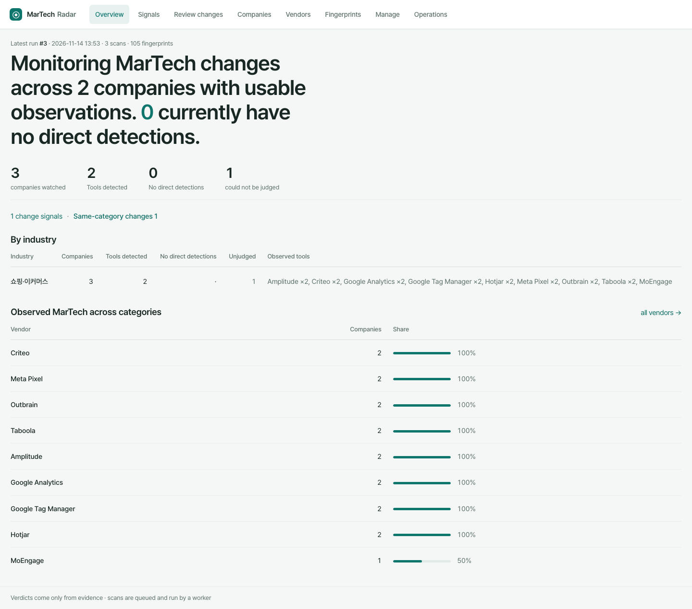
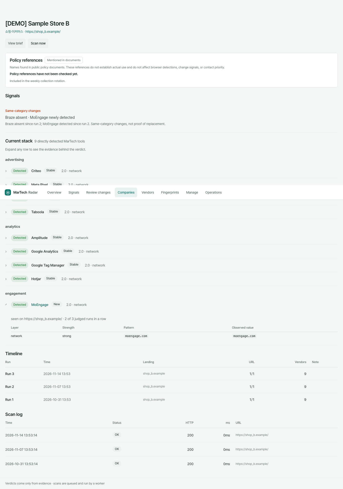

# MarTech Radar

공개 웹사이트에서 마케팅 솔루션의 흔적을 관측하고, 변화의 근거를 확인한 뒤 제안 준비까지 이어가는 벤더 중립 애플리케이션입니다.

**Codex CLI를 연결하면 별도 LLM API 키 없이 회사 조사, 유즈케이스 추천, 제안서와 연락 메일 초안을 만들 수 있습니다.** 사용자가 ChatGPT 계정으로 로그인한 Codex CLI를 앱이 실행하며, 해당 계정의 사용량과 정책이 적용됩니다. 무료·무제한 실행이나 로컬 모델을 뜻하지 않습니다. 마케팅 KB는 별도로 준비해야 합니다.

## 화면 미리보기

가상 기업 3곳의 합성 관측을 기존 데모 생성기로 만들고 실제 앱에서 캡처했습니다. 관측 수와 변화는 데모 데이터이며 운영 규모나 성과를 나타내지 않습니다.



기업별 화면에서 같은 유형의 솔루션 변화와 검출 근거, 관측 이력을 확인합니다. MoEngage 항목은 펼쳐진 상태입니다.

<details>
<summary>기업 상세와 검출 근거 보기</summary>



</details>

## 운영 경험에서 발전시킨 설계

작성자가 회사 업무에서 사용하는 버전을 기반으로 공개 소스를 구성했습니다. 공개 예제는 합성 데이터로 실행하며, 회사별 운영 규모와 업무 성과는 이 저장소에서 검증한 수치가 있을 때 제시합니다.

| 설계 질문 | 구현과 확인할 근거 |
| --- | --- |
| 수집 중 종료되면 어떤 결과가 확정되는가? | `radar/worker.py`에서 스캔·탐지·작업 완료를 `Store.transaction()`으로 묶습니다. `radar/store.py`에서 커밋과 claim 회수 경계를 확인하고, `tests/test_capacity.py`에서 중간 결과의 비노출과 rollback을 검증합니다. |
| 동시에 다른 사이트를 방문할 때 정책이 섞이는가? | 워커가 작업별 `respect_robots`를 `Collector.scan()`에 전달합니다. `tests/test_robots.py`에서 정책 처리를 검증합니다. |
| AI가 근거를 만들거나 문서 하나만 저장하면 어떻게 되는가? | `tests/test_preparation.py`는 출처 검증, 제안서·메일의 원자적 저장, 실행 잠금, 재시작 후 중단 작업 처리를 검증합니다. |
| 백업을 실제로 복원할 수 있는가? | `radar/recovery.py`와 `tests/test_hosting_readiness.py`에서 복원, 변조 및 경로 이탈 검사를 확인할 수 있습니다. |
| 수집과 AI의 책임을 어디서 나누는가? | 수집·판정은 Python 규칙으로 수행하고, 사용자가 요청한 제안 준비에 모델과 KB를 사용합니다. [구조와 데이터 흐름](docs/ARCHITECTURE.md)에 실행 경계를 설명합니다. |

현재 운영 단위는 단일 workspace와 로컬 SQLite입니다. 다중 호스트 writer, 테넌트별 권한, 실제 사이트에 대한 처리량은 별도 설계와 검증이 필요합니다. 자동 테스트의 합성·모의 결과와 실제 모델·운영 환경의 측정 결과는 각각의 실행 조건과 함께 기록합니다.

## 무엇을 할 수 있나요?

- **상시 모니터링:** Chromium으로 공개 페이지를 방문하고 네트워크·스크립트·런타임 흔적을 보관합니다. 기업별 일정, 동시 실행 한도, 작업 큐와 부하 기록을 지원합니다.
- **변화 확인:** 검출 → 미검출, 미검출 → 검출, 다시 검출 등의 관측 패턴을 구분합니다. 이전·최근 관측일, 확인 횟수, 실제 검출 근거를 함께 봅니다.
- **기업 탐색:** 업종·솔루션 유형·관측 태그를 여러 개 선택해 필터링합니다. 기업명 검색과 필터는 자동 반영되며, 기업 상세에서는 전체 요약부터 근거까지 펼쳐 볼 수 있습니다. 데스크톱 웹 중심입니다.
- **약관 참고:** 공개 개인정보 처리방침의 수탁사·제3자 제공 관련 문구를 별도로 수집합니다. 실제 브라우저 검출과 합쳐서 판정하지 않습니다.
- **제안 준비:** 회사 공개 자료와 Marketing Use Case KB로 3~5개 시나리오를 추천합니다. 사용자가 1~3개를 선택하면 제안서와 메일을 함께 작성합니다. 기본은 벤더 중립이며 제안할 솔루션과 소개 내용을 지정할 수 있습니다.
- **운영 점검:** 수집 예정 목록과 실제 결과를 대조하고 오류·누락·부하를 기록합니다. 검증된 DB 백업과 복원 도구를 제공합니다.

첫 검출은 신규 도입, 미검출은 사용 중단을 뜻하지 않습니다. 차단·시간 초과·불완전한 관측은 판단 불가로 구분합니다. 연락 여부를 결정할 때는 화면에 표시된 관측 범위와 근거를 확인해야 합니다. 메일 발송 기능은 없습니다.

## 빠르게 시작하기

Python 3.11 이상이 필요합니다. Linux/Python 3.12가 기준 환경이며, 상시 운영은 Ubuntu의 systemd를 사용합니다. Chromium 시스템 라이브러리도 필요합니다.

```bash
python3 -m venv .venv
.venv/bin/pip install -r requirements.lock
.venv/bin/pip install --no-deps -e .
.venv/bin/playwright install --with-deps chromium
cp radar.example.toml radar.toml
cp targets.example.yaml targets.yaml
```

`radar.toml`에서 한국어 UI와 수집 주기를 설정합니다. 예제 설정은 주 1회이므로 매일 수집하려면 아래와 같이 바꿉니다. 기존 섹션을 수정하고 같은 이름의 섹션을 중복 추가하지 마세요.

```toml
[scan]
locale = "ko-KR"
timezone = "Asia/Seoul"
concurrency = 3

[cadence]
default = "1d"
spread_weekly = false
daily_limit = 0

[ui]
language = "ko"
```

`targets.yaml`의 예시 기업과 URL을 모니터링할 공개 사이트로 교체합니다. 예시 도메인은 실제 수집용이 아닙니다. 기업 ID는 이력을 연결하는 키이므로 유지하세요. B2C 서비스를 관찰하려면 지주사 소개 페이지보다 실제 고객용 쇼핑·예약·서비스 페이지가 적합합니다.

```bash
bin/radar watchlist import targets.yaml
bin/radar serve --host 127.0.0.1 --port 8848
```

브라우저에서 **http://127.0.0.1:8848**을 엽니다. 화면에서 요청한 수집을 처리하려면 다른 터미널에서 워커를 실행합니다.

```bash
bin/radar worker --watch
```

한 번 수집하고 결과를 확인하려면 다음 명령을 사용합니다. 아래 배치는 자체 워커를 사용하므로 별도 상시 워커가 없어도 실행됩니다.

```bash
bin/radar batch --due
bin/radar runs
bin/radar calls
```

처음 수집한 데이터는 비교 기준입니다. 정상 관측이 쌓여야 변화를 판단할 수 있습니다. 특정 날짜 이후의 관측만 비교하려면 `[analysis].since`에 `YYYY-MM-DD`를 지정합니다. 원본 이력은 삭제하지 않습니다.

## Codex 계정으로 AI 작업 실행하기

1. [Codex CLI](https://developers.openai.com/codex/cli)를 설치하고 앱을 실행할 OS 계정에서 `codex login`으로 ChatGPT 계정에 로그인합니다.
2. `codex login status`로 로그인 방식을 확인합니다. 이 앱의 Codex 경로는 ChatGPT 로그인을 요구하며 API 키로 대체하지 않습니다.
3. [Marketing KB 검색 서비스](docs/KB_SERVICE.md)를 준비합니다. 운영자가 보유한 KB·인덱스·내부 자료는 이 저장소에 포함되어 있지 않습니다.
4. `radar.toml`의 기존 `[preparation]` 섹션을 수정합니다.

```toml
[preparation]
enabled = true
backend = "codex"
codex_binary = "codex"  # 서비스 PATH에 없다면 절대 경로
codex_model = ""        # CLI 기본 모델; 필요하면 계정에서 사용 가능한 모델 지정
mkb_url = "http://127.0.0.1:8611"
timeout_seconds = 240
```

기업 상세에서 **제안 준비하기 → 회사 조사·추천받기 → 시나리오 선택 → 제안서와 메일 만들기** 순서로 사용합니다. 작업 상태는 상단 종 아이콘에서도 확인할 수 있습니다. 문서는 복사·다운로드·인쇄해 사용하며 앱 안에서 본문을 직접 편집하거나 메일을 발송하지 않습니다.

회사 조사는 공개 기업명·업종·URL만 검색에 사용합니다. 생성 단계에는 선택한 KB 근거와 사용자가 입력한 제안 문맥을 전달합니다. 조사·추천은 버튼을 눌렀을 때 실행되며, 정기 수집에는 LLM이 필요하지 않습니다.

자세한 로그인·실행 격리·사용량·실패 처리·지원 버전은 [Codex 연동](docs/CODEX.md), 세일즈 흐름은 [제안 준비 안내](docs/SALES_PREPARATION.md)를 참고하세요. 기존 `backend="cli"`는 Claude CLI이고, `backend="anthropic"`은 별도 API 과금 방식입니다. 기존 설치의 기본 백엔드는 자동으로 바꾸지 않습니다.

## Ubuntu에서 상시 운영하기

새 설치에서 설정과 수집을 검증한 후 다음 명령으로 사용자 서비스를 설치합니다. 기존 설치에서는 같은 이름의 unit을 갱신하므로 운영 절차에 따라 적용하세요.

```bash
bin/install-service
bin/radarctl status
bin/radarctl doctor
```

설치기는 대시보드·워커, 매일 03:00 수집 타이머(최대 20분 분산), 02:45 백업 타이머를 생성하고 활성화합니다. 기본 타임존은 Asia/Seoul이며 `RADAR_TZ`로 변경합니다. 로그아웃 후에도 계속 실행하려면 해당 계정의 systemd lingering을 활성화해야 합니다. 매일 타이머가 돌아도 실제 수집 대상은 `[cadence]`에 따라 결정됩니다.

약관 자동 수집은 별도 선택 기능입니다. `python -m radar.policy_schedule`을 주간 근무 시간대에 주기적으로 실행하도록 스케줄러에 등록할 수 있습니다. 한 번에 최대 5곳, 기업별 최소 7일 간격이며 수집·생성 작업이나 호스트 부하가 있으면 연기합니다. 위 설치기는 약관 타이머를 설치하지 않습니다. [운영 안내](docs/OPERATIONS.md)에 설정 예시와 제한이 있습니다.

외부 서버에서 접속할 때는 SSH 터널이나 인증된 HTTPS 프록시를 사용하세요. 기본은 localhost입니다. 공용 인터넷에 공개하기 전에는 접근 토큰·TLS를 설정해야 하며, 사용자별 권한과 테넌트 분리는 구현되어 있지 않습니다.

```bash
bin/radar backup --keep 3
.venv/bin/python -m radar.recovery --help
```

실행 중인 SQLite 파일만 복사하지 말고 백업 명령을 사용하세요. 복원은 새 디렉터리에 수행합니다. 데이터가 한 서버에 남지 않도록 검증된 백업의 외부 보관도 별도로 설정해야 합니다.

컨테이너 격리 검증과 호스팅 준비 파일은 [deploy/README.md](deploy/README.md)에 있습니다. 배포 파일 제공만으로 특정 호스팅·기업 수에서의 성능을 보장하지 않습니다. 3천·5천 곳으로 늘릴 때는 URL 수, 방문 시간, 서버 사양에 맞춰 수집 완료 시간과 웹 응답을 함께 측정하세요.

## 저장소 구성

| 경로 | 역할 |
| --- | --- |
| `radar/` | 브라우저 수집, fingerprint 판정, SQLite 저장, 큐·일정, 신호·운영 점검 |
| `web/` | FastAPI·Jinja 대시보드, 제안 준비와 AI 백엔드 |
| `bin/` | 로컬 실행·systemd 설치·예약 수집 wrapper |
| `deploy/` | 컨테이너, 사설 생성 gateway, 호스팅 사전 점검·복원 도구 |
| `tests/` | 로컬 fixture 기반 회귀·성능·수집·AI 경계 검증 |
| `docs/` | Codex·KB·세일즈·운영 안내 |

설정과 데이터의 기준은 workspace입니다. 기본값은 현재 디렉터리이며 `RADAR_HOME` 또는 `radar --home DIR`로 분리할 수 있습니다. 기업 목록·관측·신호·초안은 `data/radar.db`, 원본 근거와 로그는 `data/`에 저장됩니다. YAML은 가져오기·내보내기 용도이고, 가져온 이후에는 DB가 기업 목록의 기준입니다. [구조와 데이터 흐름](docs/ARCHITECTURE.md)

실제 기업 목록, 운영 DB·백업, 인증 파일, 사용자별 설정, 날짜별 운영 보고서는 공개 소스에서 제외합니다. 다른 회사의 비공개 자료나 KB를 함께 배포하지 마세요. 코드 라이선스는 [MIT](LICENSE)이며 외부 자료의 이용 조건은 별도입니다.

## 개발과 검증

```bash
PYTHONPATH=. .venv/bin/pytest -q
.venv/bin/ruff check radar web tests deploy
bash -n bin/radar bin/radarctl bin/weekly-scan bin/install-service
```

테스트는 운영 DB나 로그인된 모델을 사용하지 않습니다. Chromium이 필요한 테스트에는 위 브라우저 설치가 필요합니다. 실제 Codex 호출은 자동 테스트와 분리해 별도 workspace에서 검증하세요. [기여 안내](CONTRIBUTING.md) · [보안 안내](SECURITY.md)
